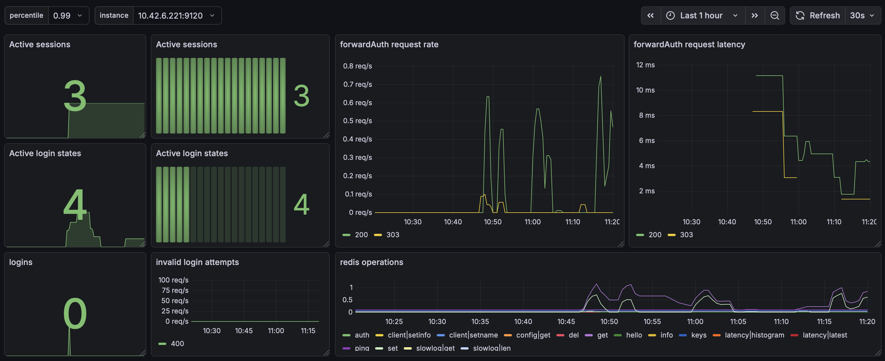

# Forward-Auth

[](https://github.com/clambin/forward-auth/releases)
[](https://app.codecov.io/gh/clambin/forward-auth)
[](https://github.com/clambin/forward-auth/actions)
[](https://github.com/clambin/forward-auth/actions)
[](LICENSE.md)

`forward-auth` is a minimal, modern implementation of Traefik’s **forwardAuth** middleware. 
It protects your web applications with OIDC authentication and flexible authorization rules.

`forward-auth` is a rewrite of [traefik-simple-auth](https://github.com/clambin/traefik-simple-auth), 
which began as a reimplementation of Thom Seddon's [traefik-forward-auth](https://github.com/thomseddon/traefik-forward-auth).
The main differences with the original are:

- authorization rules express which user has access to which application
- sessions are stored centrally: the browser cookie holds a short-lived JWT that is renewed against the session store, so sessions can be revoked
- lightweight UI to manage a user's sessions

---

## Table of Contents

- [Overview](#overview)
- [How It Works](#how-it-works)
  - [High-Level Flow](#high-level-flow)
  - [Key Components](#key-components)
- [Installation](#installation)
- [Configuration](#configuration)
  - [Example Configuration](#example-configuration)
- [Identity Provider Configuration](#identity-provider-configuration)
- [Traefik Integration](#traefik-integration)
  - [Middleware](#middleware)
  - [Authentication Endpoints & Routing](#authentication-endpoints--routing)
- [Session Management](#session-management)
  - [Session Overview (UI)](#session-overview-ui)
  - [What is a Session?](#what-is-a-session)
  - [Deleting Sessions via UI](#deleting-sessions-via-ui)
  - [Logging Out](#logging-out)
- [Metrics](#metrics)
- [Troubleshooting](#troubleshooting)
- [Author](#author)
- [License](#license)

---

## Overview

This service acts as an authentication and authorization gateway in front of your applications via Traefik.

```
Client ──► Traefik ──► forward-auth ──► OIDC Provider
              │
              └──► Upstream service (if authorized)
```

**Flow:**

1. Request hits Traefik
2. Traefik calls `forward-auth`
3. If the cookie holds a valid JWT → request is allowed
4. If the JWT has expired → it is renewed using its refresh token, provided the session still exists in the store
5. Otherwise → redirect to OIDC provider
6. After login → session is created and stored, and a JWT is sent back in the session cookie


---

## How It Works

`forward-auth` uses **OIDC authentication** to authenticate the user. Authenticated users are allocated a **session**,
which is kept in the session store. The browser receives a signed **JWT** in an **HTTP cookie**, which references that session.

### High-Level Flow

```
┌─────────┐      ┌─────────┐      ┌──────────────┐      ┌───────────────┐     ┌──────────────┐
│ Browser │      │ Traefik │      │ forward-auth │      │ OIDC Provider │     │ Application  │   
└────┬────┘      └────┬────┘      └──────┬───────┘      └──────┬────────┘     └──────┬───────┘
     │                │                  │                     │                     │
     │ Request        │ forwardAuth      │                     │                     │
     │───────────────►│─────────────────►│                     │                     │
     │                │                  │ No session          │                     │
     │ Redirect to OIDC provider (303)   │                     │                     │
     │◄───────────────│◄─────────────────│                     │                     │
     │                │                  │                     │                     │
     │ Call OIDC provider                │                     │                     │
     │────────────────────────────────────────────────────────►│                     │
     │                │                  │                     │                     │
     │                │                  │  User logs in       │                     │
     │◄────────────────────────────────────────────────────────│                     │
     │                │                  │                     │                     │
     │ Login callback │                  │                     │                     │
     │───────────────►│─────────────────►│                     │                     │
     │                │                  │  Get User details   │                     │
     │                │                  │────────────────────►│                     │
     │                │                  │◄────────────────────│                     │
     │                │                  │                     │                     │
     │                │                  │  Create session     │                     │
     │                │                  │  Set cookie         │                     │
     │◄───────────────│◄─────────────────│                     │                     │
     │                │                  │                     │                     │
     │ Retry request  │ forwardAuth      │                     │                     │
     │───────────────►│─────────────────►│                     │                     │
     │                │                  │                     │                     │
     │                │                  │  Validate JWT       │                     │
     │                │                  │  (renew if expired) │                     │
     │                │   OK (2xx)       │                     │                     │
     │                │◄─────────────────│                     │                     │
     │                │                  │                     │                     │
     │                │ Perform request  │                     │                     │
     │                │─────────────────────────────────────────────────────────────►│
```

---

### Key Components

#### forwardAuth (Traefik)

- `/api/auth/forwardauth`
- Called for every request
- Returns:
    - ✅ `2xx` → allow request
    - ❌ `303` → redirect to login
    - ❌ `403` → forbidden

#### Login Endpoint

- `/api/auth/login`
- Handles authentication callback
- Creates session
- Protects against CSRF attacks (via CSRF state token)

#### Session Store

- Stores session data (ID, user, timestamps, user agent, hashes of the current and previous refresh tokens)
- Backends:
    - `local` (in-memory)
    - `redis`

Note: Redis must be 6.2 or higher.

#### Session Cookie

- Stored in browser (`HttpOnly`, `Secure`, `SameSite=Lax`)
- Contains a JWT, signed with `server.key`, holding:
    - the session ID
    - the user's identity
    - a refresh token
- The JWT is valid for 15 minutes.
- Once the JWT has expired, `forward-auth` renews it: the refresh token is checked against the session store and,
  if the session still exists and matches the refresh token, a new JWT is issued with a new refresh token and is sent back in the cookie.
- Refresh tokens are rotated on every renewal. For a few seconds after rotation, the previous refresh token is still accepted,
  so concurrent requests carrying the same expired JWT can all renew it. After that, only the current refresh token is accepted.

#### Protected application(s)

- Protected by `forwardAuth` middleware
- Authenticated user accessible via `X-Forwarded-User-*` headers (email address, name, groups)

---

## Installation

Container images are available on [ghcr.io](https://ghcr.io/clambin/traefik-forward-auth). Images are available for linux/amd64 and linux/arm64.

---

## Configuration

Configuration is loaded from:

```
/etc/forward-auth/config.yaml
```

Override with:

```bash
forward-auth --config /path/to/config.yaml
```

### Example Configuration

```yaml
server:
  # HTTP server address. Default: ":8080".
  addr: :8080
  # HTTP Cookie Name. Default: "forward-auth-session".
  cookieName: forward-auth-session
  # Domain for which the cookie is valid. 
  # All protected hostnames (including auth) need to be subdomains of this domain.
  domain: .example.com
  # Key to sign and verify the JWT.
  # Must be at least 32 characters long.
  # Use environment variables to keep these credentials out of the configuration file.
  key: "${JWT_KEY}"
logger:
  # Logging level. Default: "info".
  level: info
  # Log format. json or text. Default: "text".
  format: json

prometheus:
  # Prometheus metrics listener. Default: ":9120".
  addr: :9120
  # prometheus metrics path. Default: "/metrics".
  path: /metrics

authn:
  # Maximum lifetime of a CSRF state token. Default: 10m.
  # Effectively, how long we wait for the user to authenticate with their OIDC provider.
  state_ttl: 10m
  # select_account determines whether the user is prompted to select an account with the OIDC provider. 
  # if true, the user is always prompted to select an account.
  # if false, the user is not prompted if already logged in at the OIDC provider.
  # Default: false.
  select_account: false
  provider:
    # OIDC provider type. oidc or github.
    type: "oidc"
    # OIDC redirect URL: OIDC redirects to this URL after the user authenticates.
    redirect_url: https://auth.example.com/api/auth/login
    # OIDC-related configuration.
    oidc:
      # OIDC client ID.
      # Use environment variables to keep these credentials out of the configuration file.
      client_id: "${OIDC_CLIENT_ID}"
      # OIDC client secret.
      # Use environment variables to keep these credentials out of the configuration file.
      client_secret: "${OIDC_CLIENT_SECRET}"
      # OIDC issuer URL.
      issuer_url: https://accounts.google.com
      # scopes to request from the OIDC provider. 
      # only override this if you know what you're doing.
      scopes: [ openid, email, profile ]
    # GitHub-related configuration. Only required for type github.
    github:
      # Oauth2 client ID.
      # Use environment variables to keep these credentials out of the configuration file.
      client_id: "${GITHUB_CLIENT_ID}"
      # Oauth2 client secret.
      # Use environment variables to keep these credentials out of the configuration file.
      client_secret: "${GITHUB_CLIENT_SECRET}"
      # scopes to request from github. 
      # only override this if you know what you're doing.
      scopes: [ user:email, read:user ]

authz:
  # Authorization rules. A request is allowed if it matches at least one rule.
  # If a rule contains both users and groups, the rule is allowed if the user matches either list.
  rules:
    - domain: "*.example.com"
      users:
        - user@example.com
    - domain: admin.example.com
      groups:
        - admins
  groups:
    - name: admins
      users:
        - admin@example.com

storage:
  # Session and CSRF state storage type. local or redis. Default: "local".
  type: redis
  # Redis configuration.
  # Use environment variables to keep these credentials out of the configuration file.
  redis:
    addr: redis:6379
    username: "${REDIS_USERNAME}"
    password: "${REDIS_PASSWORD}"
    db: 0

session:
  # Session lifetime. Default: 24h. 
  # The session is deleted from the store if the JWT hasn't been renewed within this time.
  # After that, the user needs to log in again.
  session_ttl: 24h
```

Sensitive data, such as OID client secrets and redis passwords, can be passed in as environment variables:

```
storage:
  type: redis
  redis:
    addr: redis:6379
    password: ${REDIS_PASSWORD}
    db: 0
```

---

## Identity Provider Configuration

`forward-auth` relies on an external identity provider to authenticate users.
Currently, it supports the following providers:

- OIDC
- GitHub

Only one provider is supported at a time. 

Once the provider has been configured, add the relevant information in the authn.provider section in the configuration file:
type, client_id, client_secret, issuer_url (only applicable for oidc) and redirect_url.

Detailed instructions for various providers are available in [PROVIDERS.md](PROVIDERS.md).

Configure your provider the following redirect URL:

```
https://auth.example.com/api/auth/login
```

---

## Traefik Integration

### Middleware

```yaml
apiVersion: traefik.io/v1alpha1
kind: Middleware
metadata:
  name: forward-auth
spec:
  forwardAuth:
    address: http://forward-auth:8080/api/auth/forwardauth
    trustForwardHeader: true
    authResponseHeaders:
      - X-Forwarded-User-Email
      - X-Forwarded-User-Name
      - X-Forwarded-User-Groups
    addAuthCookiesToResponse:
      - forward-auth-session
```

---

### Authentication Endpoints & Routing

You must expose `forward-auth` via Traefik for browser-based login.

#### Example HTTPRoute

```yaml
apiVersion: gateway.networking.k8s.io/v1
kind: HTTPRoute
metadata:
  name: forward-auth
spec:
  parentRefs:
    - name: traefik
  hostnames:
    - auth.example.com
  rules:
    # Login endpoint (no middleware)
    - matches:
        - path:
            type: PathPrefix
            value: /api/auth/login
      backendRefs:
        - name: forward-auth
          port: 8080

    # Everything else goes through middleware
    - matches:
        - path:
            type: PathPrefix
            value: /
      filters:
        - type: ExtensionRef
          extensionRef:
            group: traefik.io
            kind: Middleware
            name: forward-auth
      backendRefs:
        - name: forward-auth
          port: 8080
```

---

## Session Management

`forward-auth` provides basic session management capabilities, both via a UI and an HTTP API.

---

### Session Overview (UI)

The service exposes a UI where you can:

- View all active sessions
- Inspect session details (user, timestamps, etc.)
- Delete individual sessions

This UI is served by `forward-auth` itself and is **protected by the forwardAuth middleware**, meaning:

- You must be authenticated to access it
- Authorization rules (`authz.rules`) still apply

Typical access:

```
https://auth.example.com/
```

---

### What is a Session?

A session represents an authenticated user. It is made up of two parts:

**The session cookie** holds a signed JWT, containing:

- Session ID
- User identity (subject, email, name)
- Refresh token
- Expiration time (15 minutes after issue/renewal)

**The session store** (local or Redis) holds, for each session:

- Session ID
- User identity
- Hashes of the current and previous refresh tokens (the refresh tokens themselves are never stored)
- A per-session secret, used to derive the next refresh token
- The time the refresh token was last rotated
- Last user agent
- Issued at / last seen timestamps

The JWT's lifecycle:

1. At login, a new session is created in the store and a JWT is issued in the session cookie.
2. Once the JWT expires, `forward-auth` looks up the session in the store and checks the JWT's refresh token
   against the stored hashes:
   - If it matches the **current** refresh token, the refresh token is rotated: a new refresh token is derived
     from the current one and the session's secret. The current hash becomes the previous hash, and the new refresh token's hash
     becomes the current hash.
   - If it matches the **previous** refresh token, and the refresh token was rotated less than 10 seconds ago,
     the session was already renewed (typically by a concurrent request). The refresh token is not rotated again:
     the JWT receives the current refresh token instead. After those 10 seconds, the previous refresh token is rejected. 
   In both cases, the session's last seen timestamp and user agent are updated, and a renewed JWT is sent back in the cookie.
3. If the session no longer exists (it was deleted, or it expired after `session.session_ttl` without being renewed),
   or the refresh token matches neither the current refresh token nor (within the 10-second grace period) the previous one,
   the JWT cannot be renewed and the user is redirected to the identity provider to log in again.

Since the next refresh token is derived from the current one, renewing the same refresh token always produces
the same result. A browser often sends several requests at once (e.g. page assets). If these carry the same expired JWT,
they all receive the same renewed refresh token, regardless of the order in which they are processed.

Because the refresh token is rotated on every renewal, an expired JWT can effectively only be renewed once.
If a copy of an old JWT (e.g. a stolen cookie) is presented more than 10 seconds after the session has been renewed,
its refresh token is no longer accepted and renewal fails.

### Deleting Sessions via UI

From the UI, you can:

- See all active sessions
- Manually revoke sessions (e.g. logout other devices)

This is useful for:

- Security (invalidate compromised sessions)
- Administration (force logout)

Deleting a session removes it (and with it, the refresh token hashes) from the session store, so the JWT can no longer be renewed.

**Note:** deleting a session does not invalidate a JWT that has already been issued. Until that JWT expires (up to 15 minutes),
requests carrying it are still authenticated.

---

### Logging Out

To log out a session:

1. Call the delete endpoint for that session
2. The session is removed from the store
3. Subsequent requests are redirected to the identity provider

Users can only delete their own sessions. The session IDs of a user's sessions are shown in the UI,
or can be retrieved via the API:

## Metrics

`forward-auth` exposes the following Prometheus metrics on the `/metrics` endpoint:

| metric                        | type    | labels                | help                            |
|-------------------------------|---------|-----------------------|---------------------------------|
| forward_auth_session_count    | GAUGE   |                       | Number of active sessions       |
| forward_auth_state_count      | GAUGE   |                       | Number of active states         |
| http_request_duration_seconds | SUMMARY | code, handler, method | request duration in seconds     |
| http_requests_total           | COUNTER | code, handler, method | total requests processed        |

A sample Grafana dashboard is available [here](assets/grafana/dashboards.yaml).


---

## Troubleshooting

See [Troubleshooting](TROUBLESHOOTING.md).

---

## Author

Christophe Lambin

---

## License

[MIT License](LICENSE.md)
